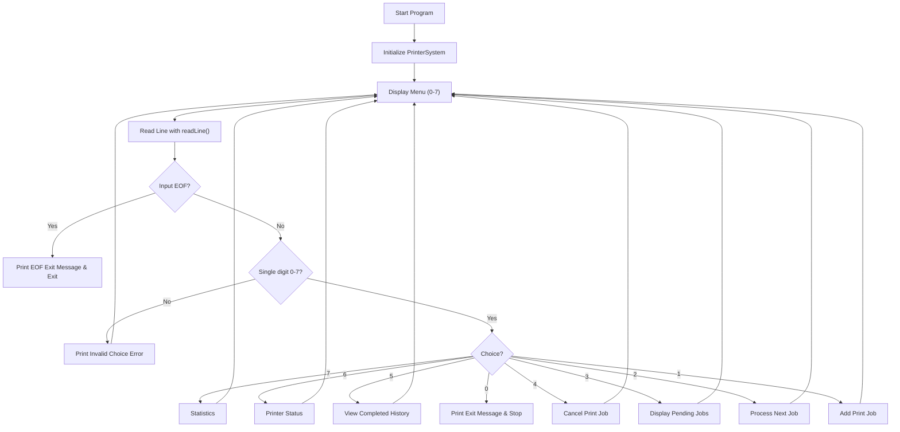
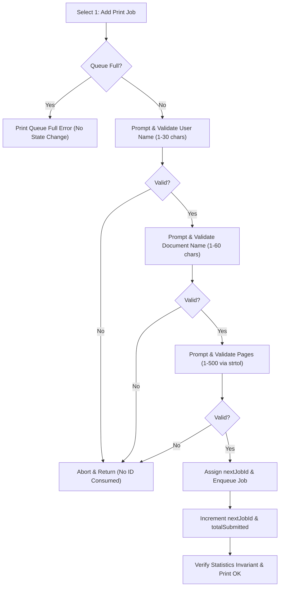
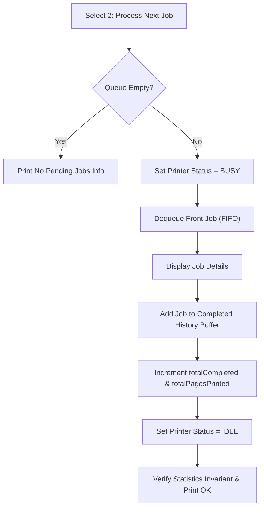
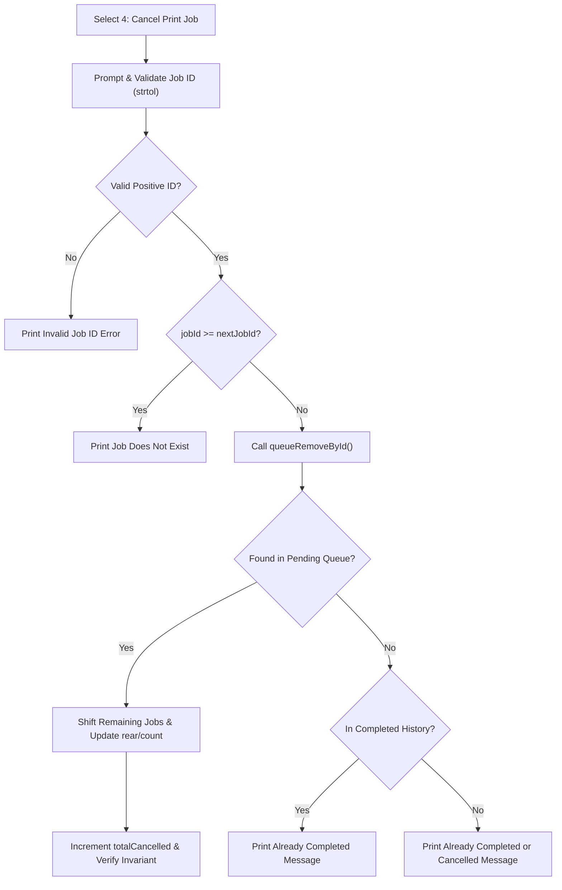

# PrintFlow Flowcharts and Diagrams

## 1. Main Menu Flow



## 2. Adding a Print Job



## 3. Processing the Next Job



## 4. Cancelling a Print Job



## 5. Circular Queue Wrap-Around Diagram (Capacity = 3)

```text
Initial (Empty): count = 0, front = 0, rear = 2
  Index:    [ 0 ]     [ 1 ]     [ 2 ]
  Data :    empty     empty     empty

After Enqueue(J1), Enqueue(J2), Enqueue(J3): count = 3, front = 0, rear = 2
  Index:    [ 0 ]     [ 1 ]     [ 2 ]
  Data :     J1        J2        J3
            ^front              ^rear

After Dequeue() x 2 (J1 and J2 printed): count = 1, front = 2, rear = 2
  Index:    [ 0 ]     [ 1 ]     [ 2 ]
  Data :    free      free       J3
                                ^front, ^rear

After Enqueue(J4), Enqueue(J5) (rear wraps 2 -> 0 -> 1): count = 3, front = 2, rear = 1
  Index:    [ 0 ]     [ 1 ]     [ 2 ]
  Data :     J4        J5        J3
                      ^rear     ^front

Logical FIFO Order via (front + offset) % 3:
  offset 0 -> (2 + 0) % 3 = index 2 -> J3
  offset 1 -> (2 + 1) % 3 = index 0 -> J4
  offset 2 -> (2 + 2) % 3 = index 1 -> J5
```
